# Лабораторная работа №1 — Эксплуатация MongoDB

**Дисциплина:** Нереляционные базы данных
**Тема:** эксплуатация MongoDB на виртуальной машине без Docker — развёртывание, ролевая модель, резервное копирование, мониторинг
**Дата выполнения:** 17–19 ноября 2026

Стенд развёртывания и сопровождения MongoDB на виртуальной машине (без Docker): базовая настройка, ролевая модель, резервное копирование и мониторинг. Автоматизация — Ansible, единая точка входа — Makefile.

## Цель работы

Пройти полный цикл сопровождения MongoDB на виртуальной машине: установить и включить авторизацию, управлять службой и убедиться, что она сама поднимается после перезагрузки, разграничить доступ ролевой моделью с реальной проверкой прав, наладить резервное копирование с проверяемым восстановлением и собрать мониторинг, на графиках которого видна реакция базы на нагрузку. Вся настройка описана кодом (Ansible) и воспроизводится одной командой `make deploy`, а повторный запуск подтверждает идемпотентность (`changed=0`).

## Окружение

| Компонент | Версия / описание |
|---|---|
| Хост управления | macOS, Apple Silicon, Ansible 2.20.5 |
| Виртуализация | UTM (Apple Virtualization), 2 vCPU / 4 GiB RAM / 20 GiB, сеть Shared |
| Гостевая ОС | Ubuntu Server 24.04.5 ARM64 (hostname `spa-db01`) |
| MongoDB | 8.0.38, официальный apt-репозиторий (`noble/mongodb-org/8.0`) |
| mongosh / database-tools | из состава mongodb-org |
| Экспортер метрик | Percona mongodb_exporter 0.54.0 (бинарник, systemd) |
| Prometheus | 2.45.3 (apt), scrape 5s, слушает 127.0.0.1:9090 |
| Grafana | 13.3.1 (apt), provisioning datasource + дашборда, слушает 127.0.0.1:3000 |
| Python на ВМ | 3.12.3, venv `/opt/spa-db/venv` с pymongo 4.x (для коллекции `community.mongodb`) |
| Коллекция Ansible | community.mongodb 1.8.1 |

Учебный сценарий — салон массажа: база `spa` (услуги, мастера, клиенты, записи на сеансы) и база `spa_analytics` (агрегаты загрузки). docker-контейнеры не используются — MongoDB развёрнута из пакетов как служба systemd.

## Подготовка окружения с нуля

1. ВМ с Ubuntu Server 24.04 ARM64 (в проекте — UTM, 2 vCPU / 4 GiB / 20 GiB, сеть Shared), пользователь с sudo, открытый SSH; IP ВМ прописывается в `inventory.yml`.
2. На управляющей машине создать два файла с паролями (вне репозитория, права 0600):
   - `~/.config/spa-db/vault-pass` — пароль ansible-vault;
   - `~/.config/spa-db/become-pass` — sudo-пароль пользователя ВМ.
3. `cp vault.example.yml group_vars/all/vault.yml`, заполнить значениями, `ansible-vault encrypt group_vars/all/vault.yml`.
4. Положить свой публичный SSH-ключ пользователю ВМ (`ssh-copy-id`).
5. `ansible-galaxy collection install -r requirements.yml`.
6. Для доступа к веб-интерфейсу Grafana: `make tunnel` → `http://localhost:13000`.

## Структура

```
01-mongodb/
├── Makefile               # единый вход: make deploy | status | stop | ...
├── ansible.cfg            # inventory, vault, become-пароль (файл вне репо)
├── inventory.yml          # хост spa-db (IP ВМ)
├── requirements.yml       # community.mongodb 1.8.1
├── vault.example.yml      # образец секретов (реальные — в зашифрованном vault)
├── site.yml               # полный bring-up: deploy → rbac → seed → monitoring
├── ops.yml                # разовые операции с тегами (не выполняются без --tags)
├── ops_tasks/             # блоки операций: сервис, RBAC-демо, бэкапы, load, проверка мониторинга
├── group_vars/all/        # main.yml (параметры) + vault.yml (секреты, ansible-vault)
├── roles/
│   ├── deploy/            # установка MongoDB 8.0 из apt, systemd, health-check
│   ├── rbac/              # включение авторизации, кастомные роли, пользователи, матрица доступа
│   ├── seed/              # учебные данные (идемпотентный upsert)
│   ├── monitoring/        # mongodb_exporter + Prometheus + Grafana (provisioning)
│   └── ...
├── load/load_gen.py       # генератор нагрузки (ramp-up + устойчивая фаза)
├── assets/                # скриншоты и артефакты прогонов
└── README.md              # этот отчёт
```

## Часть 1. Базовая настройка

### 1.1 Развёртывание

Роль `deploy` добавляет официальный репозиторий MongoDB (deb822, подпись server-8.0.asc), устанавливает `mongodb-org`, рендерит `/etc/mongod.conf` (`bindIp: 127.0.0.1`; секция `security.authorization` включается флагом `auth_enabled` — история включения описана в Части 2), поднимает службу systemd и завершается health-check: `mongosh --eval 'db.adminCommand({ ping: 1 }).ok'` с assert'ом, что результат равен `1`.

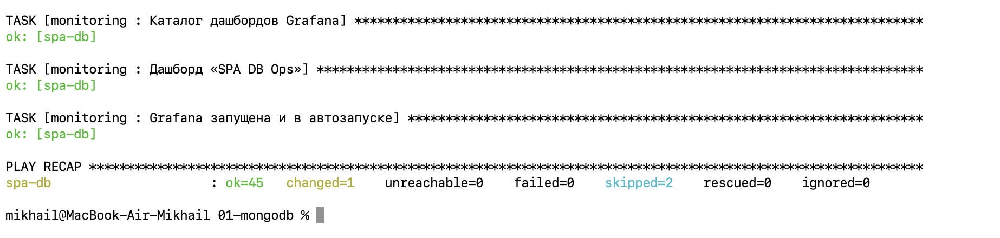

### 1.2 Автозапуск после перезагрузки

Служба включена в автозапуск (`systemctl enable mongod`). Проверка — реальная перезагрузка ВМ плейбуком `ansible.builtin.reboot`, после загрузки: `is-enabled` = `enabled`, `is-active` = `active`, ping отвечает. Доказательство самостоятельного старта — сравнение времени загрузки ОС и старта mongod: ОС загрузилась в 17:54:55, mongod стартовал в 17:54:57 (через 2 секунды после ОС).

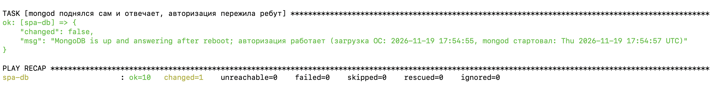

### 1.3 Остановка, запуск, перезапуск

`make stop / start / restart` — `systemd` + ожидание закрытия/открытия порта 27017 + assert'ы. При перезапуске фиксируется смена PID (520393 → 522144), что доказывает фактический перезапуск процесса, а не повторный вызов start.

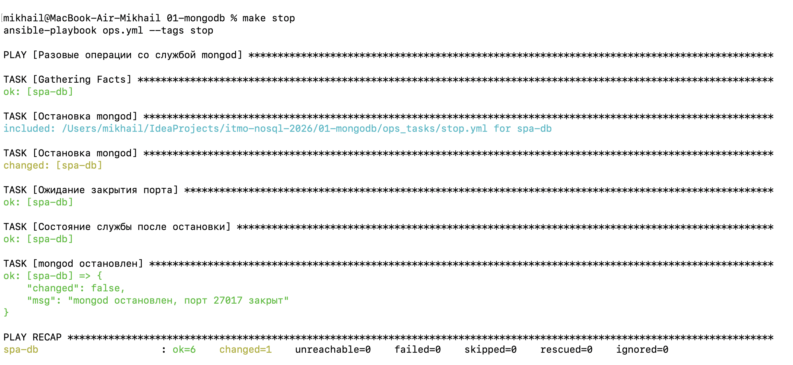
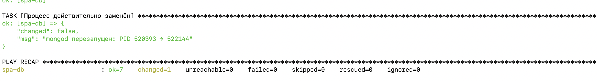

### 1.4 Проверка доступности

- положительная: `ping` через mongosh → `ok: 1`, вердикт плейбука «MongoDB доступна: ping ok=1»;
- доступ с контрольной машины: `ansible -m ping spa-db` → `pong`.

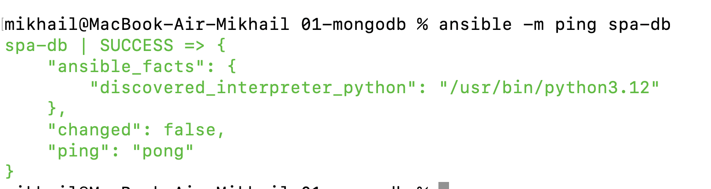
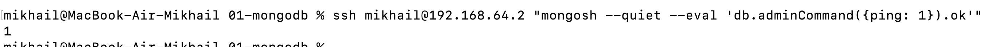

## Часть 2. Ролевая модель

Bootstrap: роль `deploy` рендерит конфиг с включённой авторизацией; администратор `spaAdmin` (role `root@admin`) создаётся сразу после первого старта через localhost exception, файл-маркер `/var/lib/mongodb/.spa_admin_created` появляется только после успешного `createUser` и проверки входа администратора. Негативная проверка после включения авторизации: анонимный `find` по коллекции клиентов отклонён сервером («Command find requires authentication»).


### 2.1 Пользователи

| Пользователь | Назначение | Роли |
|---|---|---|
| `spaAdmin` | администратор стенда | root@admin |
| `frontdesk01` | стойка записи | frontDeskOperator |
| `curator01` | ведение каталога услуг | spaMenuCurator |
| `cards01` | картотека клиентов | clientCardsOnly |
| `archiveOperator` | резервное копирование | backup + restore (админ) |
| `metricsAgent` | экспортер метрик | clusterMonitor + read@local |

### 2.2 Кастомные роли

| Роль | Привилегии |
|---|---|
| `frontDeskOperator` | appointments: find/insert/update/remove; services, masters: find |
| `spaMenuCurator` | services: find/insert/update (позже расширяется до +remove) |
| `clientCardsOnly` | только коллекция clients: find |

Каждый шаг настройки завершается поведенческой матрицей доступа: `make rbac-setup` включает авторизацию и создаёт роли/пользователей, `make rbac-matrix` выполняет `access-matrix.js` — реальные операции от имени каждого пользователя со сверкой результата с ожиданием (allow/deny по коду ошибки 13; ошибка входа фиксируется отдельным вердиктом). Allow-пробы пишут только в собственные документы (уникальный код за прогон) и проверяют фактический результат — `insertedId` и `modifiedCount`, deny-пробы бьют по реальным документам — сервер отклоняет их, данные не меняются. Ошибка входа фиксируется отдельным вердиктом и не смешивается с отказом по правам.

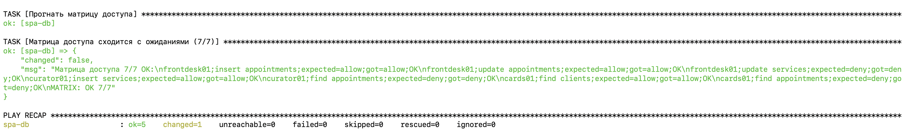
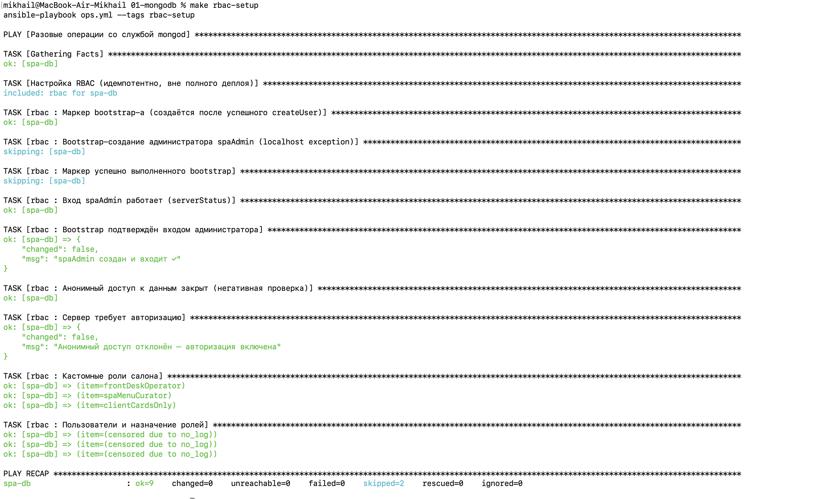

### 2.3 Выдача и отзыв ролей

`cards01` получает роль `frontDeskOperator` — доступ к расписанию появляется; отзыв возвращает исходное состояние. До/после проверяются реальными запросами, а не чтением метаданных: DENIED → ALLOWED → DENIED.

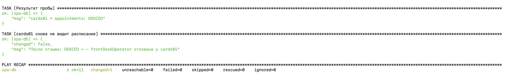

### 2.4 Изменение набора операций роли

`spaMenuCurator` расширяется привилегией `remove` на коллекцию услуг. До изменения: `[find, insert, update]`, после: `[find, insert, remove, update]` (по `rolesInfo {showPrivileges: true}`). Метаданные роли до и после расширения сравниваются по `rolesInfo {showPrivileges: true}`; поведенческое подтверждение после расширения — `curator01` удаляет пробную услугу (`deleteOne`), счётчик удалённых документов показывает, что новая привилегия реально работает.

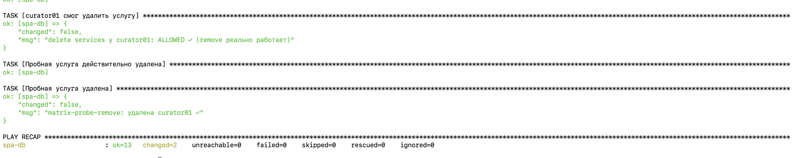

### 2.5 Доступ только к одной коллекции

Роль `clientCardsOnly` описана с resource `{ db: spa, collection: clients }` — пользователь `cards01` читает картотеку клиентов, но любая попытка обратиться к расписанию (`appointments`) возвращает отказ сервера (код 13). Отдельная строка матрицы доступа фиксирует это поведение.

### 2.6 Удаление роли и пользователя

Временная пара `trialRole` + `trialUser` создаётся, проверяется и удаляется; контроль отсутствия: `getUser`/`getRole` возвращают `null` (`user=absent role=absent`). Реальный вывод прогона:

```
"msg": "trialUser создан и читает services ✓"
"msg": "trialUser и trialRole удалены (user=absent role=absent) ✓"
```

## Часть 3. Резервное копирование и восстановление

Копии делаются `mongodump --gzip --archive` от имени выделенного пользователя `archiveOperator` (встроенные роли backup + restore). Пароль передаётся через конфиг-файл `/root/.mongo-tools.ini` (0600) с флагом `--config` — в списке процессов пароля нет. Каждая копия получает уникальное имя (UTC-штамп со случайным суффиксом): повторный прогон добавляет новую копию, а не перезаписывает предыдущую.

### 3.1 Копия одной базы

`make backup-one` → `/var/backups/mongodb/one/spa_<UTC>.archive.gz`, после создания проверяется существование и размер файла.

### 3.2 Копии всех учебных баз

`make backup-all` — mongodump выполняется по каждой учебной базе (`spa`, `spa_analytics`), архивы в `/var/backups/mongodb/all/spa-full-<db>_<UTC>.archive.gz`.

### 3.3 Несколько копий без перезаписи

Повторные прогоны `make backup-one` / `make backup-again` добавляют копии с новыми штампами:

```
/var/backups/mongodb/one:
  spa_20261117T214510Z.archive.gz   spa_20261117T214533Z.archive.gz
  spa_20261117T214521Z.archive.gz   spa_20261117T214633Z.archive.gz
  spa_20261117T214655Z.archive.gz   spa_20261117T214718Z.archive.gz
  spa_20261117T214741Z.archive.gz   spa_20261117T215122Z.archive.gz
/var/backups/mongodb/all:
  spa-full-spa_20261117T214635Z.archive.gz          spa-full-spa_20261117T214658Z.archive.gz
  spa-full-spa_analytics_20261117T214636Z.archive.gz  spa-full-spa_analytics_20261117T214659Z.archive.gz
```

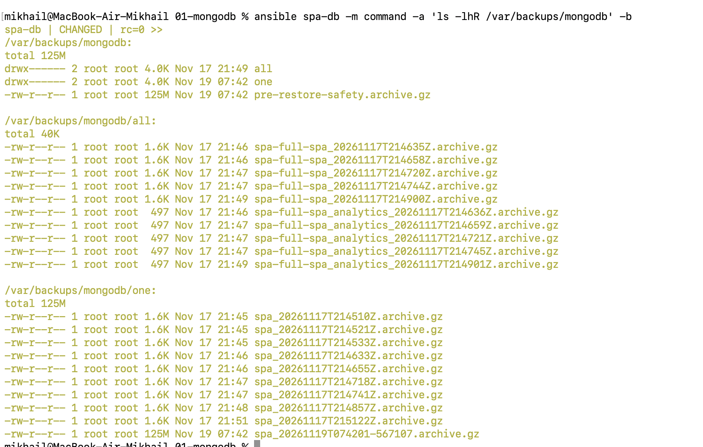

### 3.4 Восстановление коллекции

Сценарий потери данных: коллекция `appointments` удаляется, затем восстанавливается из свежайшей копии (`mongorestore --nsInclude spa.appointments --drop`). Безопасность операции: перед удалением архив разворачивается в изолированную коллекцию `restore_check` и сверяется с состоянием до потери — реальная коллекция не тронута, пока архив не подтверждён; дополнительно делается страховочная копия текущего состояния. Сверка результата: количество документов до удаления и после восстановления совпадает, соседняя коллекция `services` не затронута (6 документов); содержимое не побайтово — сверяется число документов. Отдельно проверено поведение при отсутствии копий: плейбук падает с явным сообщением «В /var/backups/mongodb/one нет ни одной копии — восстановление невозможно», не выполняя удаление.

Реальный вывод прогона:

```
"msg": "Пробное восстановление: 113432 записей в restore_check ✓ архив валиден"
"msg": "appointments удалена ✓"
"msg": "Восстановление подтверждено: appointments 113432 → 113432, services = 6 (не тронута) ✓
        источник: /var/backups/mongodb/one/spa_20261119T074201-567107.archive.gz"
```

## Часть 4. Мониторинг

### 4.1 Экспортер

Percona mongodb_exporter 0.54.0 установлен бинарником как служба systemd (`mongodb-exporter.service`), работает под непривилегированным пользователем. Подключение к MongoDB — под пользователем `metricsAgent` (role `clusterMonitor`, плюс чтение служебной базы `local`); URI с паролем хранится в Environment-файле с правами 0600. Активные коллекторы: diagnosticdata, dbstats, collstats по коллекциям `spa.appointments` и `spa.services`; включён совместимый режим метрик (`mongodb_ss_*`). Экспортер слушает `127.0.0.1:9216`.

### 4.2 Метрики и их обоснование

| Метрика | Что показывает | Зачем |
|---|---|---|
| `mongodb_up` | экспортер видит сервер | базовая доступность |
| `mongodb_ss_connections` | текущие/доступные подключения | исчерпание пула под нагрузкой |
| `mongodb_ss_opcounters` (лейбл `legacy_op_type`) | операции/сек по типам (find/insert/update/command) | профиль рабочей нагрузки |
| `mongodb_mongod_op_latencies_*` | средняя латентность чтения/записи | деградация отклика |
| `mongodb_ss_wt_cache_bytes_currently_in_the_cache / maximum_bytes_configured` | заполнение кэша WiredTiger, % | узкое место чтения |
| `mongodb_ss_mem_resident` | резидентная память mongod | потребление ОЗУ |
| `rate(mongodb_ss_network_bytesIn/bytesOut[1m])` | входящий/исходящий трафик | объём передаваемых данных |
| `rate(mongodb_ss_opcounters{legacy_op_type="insert"}[1m])` | скорость вставки записей | прямая метрика тестовой нагрузки |

### 4.3 Дашборд

Grafana 13.3.1 развёрнута через apt, datasource и дашборд подключены provisioning-механизмом (без ручных действий в UI). Дашборд «SPA DB Ops» — 8 панелей: Up, подключения, операции/сек по типам, латентность, заполнение кэша WiredTiger (%), резидентная память, сетевой трафик, скорость вставки записей. Веб-интерфейс доступен только через SSH-туннель (`make tunnel`), анонимный доступ из браузера — только чтение.

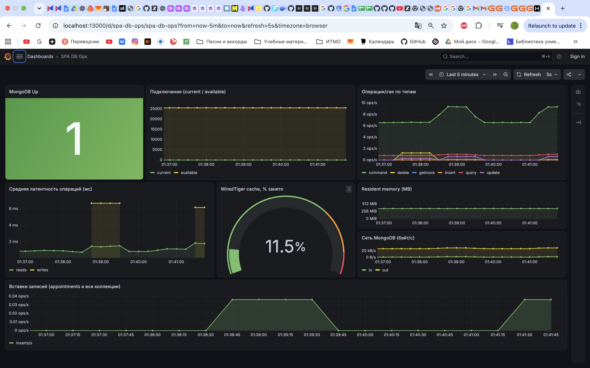

### 4.4 Нагрузка и влияние на графиках

Проверка цепочки мониторинга перед нагрузкой (`make monitor-check`): «мониторинг зелёный: exporter (9216) → prometheus up=1 → grafana 13.3.1, дашборд «SPA DB Ops» на месте».

Генератор `load/load_gen.py` (pymongo) работает под пользователем `frontdesk01`: ramp-up 30 с (1 → 4 потока) и устойчивая фаза 120 с. Операции — вставка записей в `appointments` (документ с payload ~1,5 КиБ), чтение каталога услуг, обновление статуса записи. Итоговые счётчики прогона: 21 378 вставок, 21 378 чтений, 7 126 обновлений за 150 секунд.

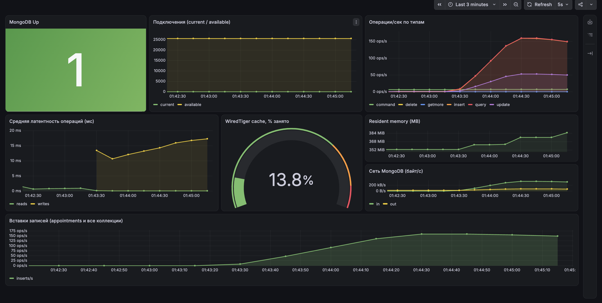
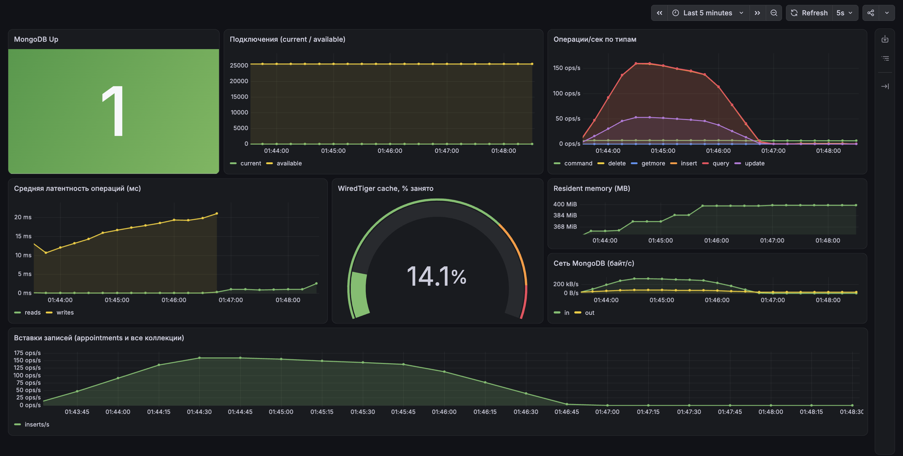
Отчёт генератора: [assets/16-load-counters.txt](assets/16-load-counters.txt)

Влияние на графиках (данные дашборда до / под нагрузкой / после):

| Панель | До | Под нагрузкой | После |
|---|---|---|---|
| Вставки записей | ~0 ops/s | ramp до ~160 ops/s | спад к 0 |
| Латентность writes | ~11 мс | рост до ~20 мс | остаётся повышенной до перезаписи кэша |
| Resident memory | 352 MiB | рост до 400 MiB | остаётся (кэш) |
| Сеть (in) | ~0 B/s | ~200 kB/s | спад |
| WiredTiger cache | 11,5 % | 14,1 % | остаётся повышенной (кэш не вытесняется сразу) |

## Идемпотентность

Повторный полный прогон `make deploy` не выполняет изменений: PLAY RECAP — `changed=0` (вторая колонка доказывает отсутствие накопления состояния при перезапусках конфигурации). Сценарии grant/revoke/modify/trial и бэкапы также можно перезапускать: каждая операция приводит систему к описанному состоянию и завершается проверкой результата.

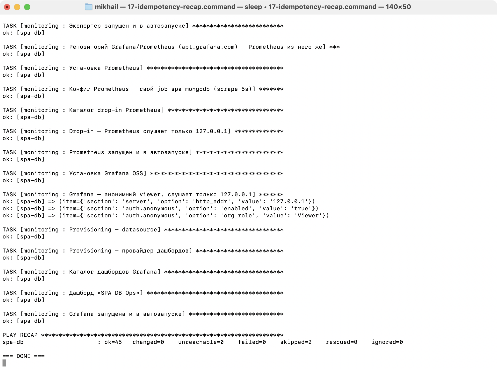

## Проблемы, возникшие при выполнении, и их решения

1. **pymongo на Ubuntu 24.04.** Системный python3-pymongo слишком старый для коллекции `community.mongodb` — она падает на вызовах модулей. Решение: отдельный venv `/opt/spa-db/venv` с pymongo 4 и `ansible_python_interpreter` на задачи RBAC.
2. **Становится недоступен sudo из Ansible.** Переменная `ansible_become_password` не может быть задана через `group_vars` — префикс `ansible_*` зарезервирован. Решение: `become_password_file` в `ansible.cfg`, файл пароля вне репозитория.
3. **Теги и include_tasks.** Тег `never` на include наследуется внутренними задачами и полностью блокирует их при `--tags <операция>`. Решение: `never` остаётся на include, а внутренние блоки несут явные теги операций.
4. **Тайное становится явным.** `group_vars/vault.yml` как файл не загружается автоматически — Ansible читает `group_vars/<группа>.yml` или каталог `group_vars/all/`. Решение: каталог `group_vars/all/` с `main.yml` и `vault.yml`.
5. **mongodb_exporter 0.54.** Имя релизного артефакта — `linux-arm64` через дефис; для метрик `mongodb_ss_*` нужен `--compatible-mode`; systemd не разбивает переменную окружения в `ExecStart` на аргументы — флаги прописаны в юните литерально.
6. **mongodump и несколько баз.** Утилита принимает одну `--db` за прогон — «копия всех баз» выполняется циклом, архив на каждую базу.
7. **Хендлеры при упавшем деплое.** Если прогон завершился ошибкой, накопленные уведомления хендлеров не выполняются — после каждого исправления деплой перезапускался полностью и верифицировался `make monitor-check`.

## Сводка проверки

| Проверка | Результат | Подтверждение |
|---|---|---|
| Установка MongoDB 8.0, авторизация включена | ✓ | кадр 02, health-check «ping ok=1» |
| Остановка / запуск / перезапуск | ✓ | кадр 04 — порт закрыт; кадр 05 — PID 520393 → 522144 |
| Автозапуск после перезагрузки | ✓ | кадр 06 — mongod стартовал через 2 с после ОС, авторизация работает |
| Ролевая модель, все 6 шагов | ✓ | кадры 08–11, матрица 7/7, удаление пробной услуги curator01 |
| Резервные копии | ✓ | кадр 12 — копии не перезаписываются (UTC-штампы) |
| Восстановление коллекции | ✓ | probe-restore в `restore_check` + 113432 → 113432, `services` не тронута |
| Мониторинг | ✓ | exporter → Prometheus up=1 → Grafana, дашборд provisioned |
| Нагрузка и влияние на графиках | ✓ | кадры 13–15, 21 378 insert / 21 378 find / 7 126 update |
| `make deploy` повторно | ✓ | кадр 17 — changed=0 |

## Выводы

Полный цикл сопровождения MongoDB собран в виде кода и воспроизводится с нуля одной командой. Самым интересным оказался переход авторизации: localhost exception разрешает ровно одно действие, поэтому bootstrap администратора приходится делать до включения `security.authorization`, а маркер-файл — класть только после успешного `createUser` и проверки входа. Самым коварным — восстановление после нагрузочного теста: к этому моменту в коллекции больше ста тысяч документов, поэтому архив перед удалением реальной коллекции сначала разворачивается в изолированную `restore_check` и сверяется по количеству записей. Поведенческая матрица доступа оказалась честнее проверки метаданных: право можно «иметь по документации», но пока операция от имени пользователя реально не выполнилась (или не отклонилась с кодом 13), гарантий нет. Идемпотентность себя оправдала: после исправлений повторный деплой проходит с `changed=0`, что позволяет без риска докатывать конфигурацию поверх живого стенда.

## Как запустить

```bash
ansible-galaxy collection install -r requirements.yml   # однократно
make deploy        # полный bring-up: MongoDB → RBAC → данные → мониторинг
make status        # состояние службы
make rbac-setup    # настройка RBAC (без матрицы)
make rbac-matrix   # поведенческая матрица доступа (после rbac-setup)
make rbac-grant    # демо: выдача роли (проверки до/после)
make rbac-revoke   # демо: отзыв роли — запускать после rbac-grant
make rbac-modify   # демо: расширение роли remove + удаление пробной услуги
make rbac-trial    # демо: создание и удаление trial-пары
make backup-one    # копия базы spa
make backup-all    # копии всех учебных баз
make restore       # безопасное восстановление appointments из свежайшей копии
make monitor-check # проверка цепочки экспортер → Prometheus → Grafana
make load          # нагрузка (150 с) на учебную базу
make tunnel        # SSH-туннель для веб-интерфейса Grafana (localhost:13000)
```
