# Лабораторная работа №2 — Эксплуатация OpenSearch 3.8

> `subjects/nosql-databases/02-opensearch`

## Задача

Развернуть защищённый кластер OpenSearch, настроить автоматическое управление жизненным циклом логов и подключить мониторинг.

## Чек-лист

### Развёртывание

- [x] [Развернуть кластер OpenSearch в виде Hot-Warm архитектуры](#часть-1-развёртывание)
- [x] [Настроить TLS-шифрование на транспортном и REST-уровне](#часть-1-развёртывание)
- [x] [Развернуть Dashboard](#часть-1-развёртывание)

### Ролевая модель

- [x] [Создать роль записи: право на запись только в data stream `logs`](#часть-2-ролевая-модель)
- [x] [Создать роль чтения: право только на чтение индексов `logs*`](#часть-2-ролевая-модель)
- [x] [Создать роль мониторинга: права на получение метрик кластера и узлов](#часть-2-ролевая-модель)
- [x] [Создать 3 пользователей и выдать им созданные роли](#часть-2-ролевая-модель)

### Управление индексами

- [x] [Развернуть страницу на nginx и настроить логирование в формате JSON](#часть-3-логи-и-управление-индексами)
- [x] [Развернуть перекладчик логов: Fluent Bit читает JSON-логи nginx и отправляет в OpenSearch](#часть-3-логи-и-управление-индексами)
- [x] [Создать шаблон для индекса логов nginx](#часть-3-логи-и-управление-индексами)
- [ ] Настроить политику хранения: логи хранятся 10 минут, после чего удаляются; максимальный размер индекса 1 МБ либо время жизни 1 минута (срабатывает то условие, которое наступит раньше)

  Политика настроена, rollover по возрасту, перенос и удаление проверены.
  Rollover по размеру 1 МБ подтверждён на отдельном потоке с увеличенным
  возрастным порогом. Для основного потока с порогом 1 минута отдельно не
  установлено, какое условие вызвало конкретный rollover.

### Мониторинг

- [x] [Настроить плагин Prometheus для получения метрик от OpenSearch](#часть-4-мониторинг)
- [x] [Выбрать метрики, полезные для анализа состояния и производительности OpenSearch](#часть-4-мониторинг)
- [x] [Создать дашборд для отображения выбранных метрик](#часть-4-мониторинг)

## Цель работы

Развернуть защищённый Hot-Warm-кластер OpenSearch, разграничить доступ к
журналам, настроить сбор логов nginx и управление их жизненным циклом,
подключить мониторинг состояния и производительности.

## Часть 1. Развёртывание

В Docker Compose работают два узла OpenSearch 3.8.0:

- `os-hot` совмещает роли cluster manager, data и ingest; атрибут — `temp=hot`.
- `os-warm` хранит данные с атрибутом `temp=warm`.

Политика ISM переносит индексы по атрибутам узлов. Единственный узел cluster
manager — учебный компромисс: при его отказе кластер недоступен для управления.

Для транспортного и REST-соединений включён TLS. Сертификаты узлов и
локальный корневой CA создаются при подготовке стенда. Каждый узел получает
только свой закрытый ключ; сервисы Dashboards, Fluent Bit и Prometheus
получают публичный сертификат CA.

Подготовка разделена на последовательные одноразовые сервисы:

1. `certs` создаёт PKI с помощью OpenSSL.
2. `users-seed` создаёт bcrypt-хэши и `internal_users.yml`.
3. `security-seed` дополняет security-конфигурацию штатными файлами образа.

OpenSearch запускается после успешного завершения этих этапов. Повторный
запуск сохраняет существующие ключи и начальные пароли.
Для тома security у узлов отключено автоматическое копирование файлов из
образа: первичное содержимое создают стадии подготовки.

Веб-интерфейс OpenSearch Dashboards подключён к `os-hot` по HTTPS с проверкой
сертификата.

## Часть 2. Ролевая модель

| Пользователь | Роль | Назначение |
|---|---|---|
| `logshipper` | `accessLogIngest` | Запись логов в поток `logs` |
| `analyst01` | `accessLogAnalyst`, `kibana_user` | Чтение `logs*` и работа с Dashboards |
| `metricsAgent` | `platformMonitor` | Получение метрик кластера и узлов |

`make rbac-matrix` проверяет права реальными запросами. После настройки
получено 13 успешных проверок: отправителю разрешена запись, чтение и удаление
потока отклоняются; запрет удаления потока проверен через имитацию проверки
прав без удаления данных. Аналитику разрешён поиск, но не запись; сборщик метрик
получает данные с обоих узлов, но не может записывать документы. Отдельные
запросы на удаление и обновление документа от имени `logshipper` вернули 403.

## Часть 3. Логи и управление индексами

nginx обслуживает учебную страницу и записывает access-лог в JSON. Fluent Bit
читает файл, хранит позицию чтения в отдельном томе и отправляет записи
в data stream `logs`. Шаблон `logs-template` задаёт поля, один первичный
шард и размещение нового индекса на hot-узле.

Политика `logs-lifecycle` выполняет rollover при достижении 1 МБ или возраста
1 минута, переносит старое поколение на warm с запретом записи, а при возрасте
индекса 10 минут удаляет его. Проверка условий ISM периодическая: значения
в политике — пороги, а не гарантия срабатывания в ту же секунду.

### Проверка rollover по размеру

Размерное условие проверено на отдельном тестовом потоке с порогами `1mb`
и `3650d`. Политика основного потока не менялась.

- После записи 128 документов размер primary store составил 4 224 616 байт.
- Dry-run показал выполненное условие размера и невыполненное условие возраста.
- Затем ISM выполнил rollover. В отчёте указаны размер `4mb`, возраст `2m`
  и возрастной порог `3650d`.

Проверка подтверждает работу размерного условия, но не показывает, какое
условие вызвало rollover в потоке `logs` с возрастным порогом `1m`.

### Проверка пайплайна и setup

В одном из проверочных прогонов 300 из 300 запросов с маркером появились
в потоке. Для `.ds-logs-000033` затем наблюдались новое поколение,
перенос на `os-warm` с `index.blocks.write=true` и удаление старого индекса.
`make pipeline-check` отдельно подтвердил доставку 200 тестовых запросов и
размещение текущего индекса записи на `os-hot`.

После добавления jq первый и повторный запуск `setup` проверены в отдельном
Compose-проекте на новых томах. Политика соответствовала конфигурации после
обоих запусков; матрица доступа прошла 13/13 до и после повторного запуска,
а отдельная проверка pipeline нашла все 200 тестовых запросов.

## Часть 4. Мониторинг

На обоих узлах установлен prometheus-exporter 3.8.0.0. Prometheus собирает
метрики по HTTPS от имени `metricsAgent`; datasource и дашборд Grafana
подключаются через provisioning.

| Метрика | Для чего используется |
|---|---|
| Состояние кластера и неназначенные шарды | Доступность и распределение данных |
| Занятость JVM heap и время GC | Нагрузка на память узлов |
| CPU и свободное место | Потребление ресурсов |
| Скорость индексации и поиска | Рабочая нагрузка |
| Документы и размер поколений логов | Приём данных и работа ISM |

`make monitor-check` подтвердил доступность экспортёра на обоих узлах,
две цели Prometheus со статусом up, JVM-метрики обоих узлов и наличие
дашборда Grafana.

## Сводка проверок

| Проверка | Результат |
|---|---|
| Чистый запуск на отдельных томах | Контейнеры прошли проверки готовности |
| Ролевая модель | 13/13 |
| Приём логов и шаблон | Доставлены 200 уникальных тестовых запросов |
| Мониторинг | Обе цели Prometheus доступны, метрики и дашборд найдены |
| Цикл ISM | Rollover → warm/read-only → удаление |

## Окружение и запуск

Стенд рассчитан на Docker Compose с поддержкой `volume.subpath`. В нём используются OpenSearch и OpenSearch
Dashboards 3.8.0, плагин prometheus-exporter 3.8.0.0, nginx, Fluent Bit,
Prometheus и Grafana. Опубликованные порты привязаны к `127.0.0.1`.

### Первый запуск

1. Создать файл `02-opensearch/.env` по образцу `.env.example` и задать
   разные надёжные пароли. Этот файл не включается в Git.
2. Из каталога `02-opensearch` запустить `make up`.
3. Проверить состояние контейнеров командой `make status`, затем выполнить
   `make rbac-matrix`, `make pipeline-check` и `make monitor-check`.

### Пересборка образа

После изменений `Dockerfile.os` образ нужно пересобрать командой
`docker compose build` перед развёртыванием. В нём установлен jq для разбора
ответа ISM. Пересборка и последующий запуск существующего стенда могут
пересоздать контейнеры; `setup` повторно применяет настройки и записывает
файл пароля Prometheus, поэтому сначала следует оценить эти побочные эффекты.

### Адреса интерфейсов

| Сервис | Адрес |
|---|---|
| OpenSearch | `https://127.0.0.1:9200` |
| Dashboards | `http://127.0.0.1:5601` |
| nginx | `http://127.0.0.1:8080` |
| Prometheus | `http://127.0.0.1:9090` |
| Grafana | `http://127.0.0.1:3000` |

### Остановка и проверка

`make down` останавливает контейнеры, сохраняя тома. `make verify` проверяет
существующий стенд и не удаляет тома, но его `compose up` может повторно
запустить `setup` с описанными выше побочными эффектами. Удаление томов приводит к потере данных,
состояния мониторинга и локального центра сертификации.

## Структура файлов

```text
02-opensearch/
├── .env.example                  # образец переменных и паролей
├── docker-compose.yml            # сервисы, сеть, тома и проверки готовности
├── Dockerfile.os                 # образ OpenSearch с плагином Prometheus
├── Makefile                      # команды запуска и проверок
├── README.md                     # задание, отчёт и инструкция
├── certs/
│   ├── make-certs.sh             # создание локального CA и сертификатов
│   └── pki-state.sh              # проверка состояния PKI и seed
├── checks/
│   ├── client.py                 # HTTP-клиент с авторизацией и проверкой CA
│   ├── rbac.py                   # проверка прав пользователей
│   ├── pipeline.py               # проверка доставки логов и индекса записи
│   ├── cycle.py                  # проверка полного цикла ISM
│   └── monitor.py                # проверка экспортёра, Prometheus и Grafana
├── config/
│   ├── os-hot.yml                # настройки hot-узла
│   └── os-warm.yml               # настройки warm-узла
├── dashboards/
│   └── opensearch_dashboards.yml  # подключение Dashboards к OpenSearch
├── fluentbit/
│   ├── fluent-bit.conf           # чтение и отправка access-лога
│   └── parsers.conf              # JSON-парсер
├── grafana/
│   ├── dashboards/coffee-os.json # панели мониторинга OpenSearch
│   └── provisioning/             # автоматическое подключение источника и дашборда
├── load/
│   └── load.js                   # сценарий HTTP-нагрузки k6
├── nginx/
│   ├── nginx.conf                # формат JSON-лога и настройки страницы
│   └── site/index.html           # учебная страница кофейни
├── prometheus/
│   └── prometheus.yml            # сбор метрик с двух узлов по HTTPS
├── setup/
│   ├── security-seed.sh          # подготовка начальных конфигураций безопасности
│   ├── make-users.sh             # создание bcrypt и initial users
│   ├── setup.sh                  # применение ролей, политики и шаблона
│   ├── ism-policy.sh             # проверка и обновление ISM-политики
│   └── config/                   # JSON-файлы ролей, ISM и шаблона индексов
└── tests/                        # модульные тесты клиентского кода и конфигурации
```

В `setup/config/` файлы `ingest-role.json`, `analyst-role.json` и
`monitor-role.json` описывают роли; `log-writes.json` — группу действий записи;
`lifecycle.json` — политику ISM; `log-template.json` — шаблон потока логов.
Рабочий `.env` создаётся локально и не добавляется в Git.

## Скриншоты

Ниже приведены результаты проверок и снимки дашборда во время эксперимента.

### Кластер и TLS

Статус стенда показывает работающие сервисы и два узла OpenSearch.
Настройки транспортного и REST TLS приведены в конфигурациях узлов;
отдельного скриншота проверки сертификата здесь нет.

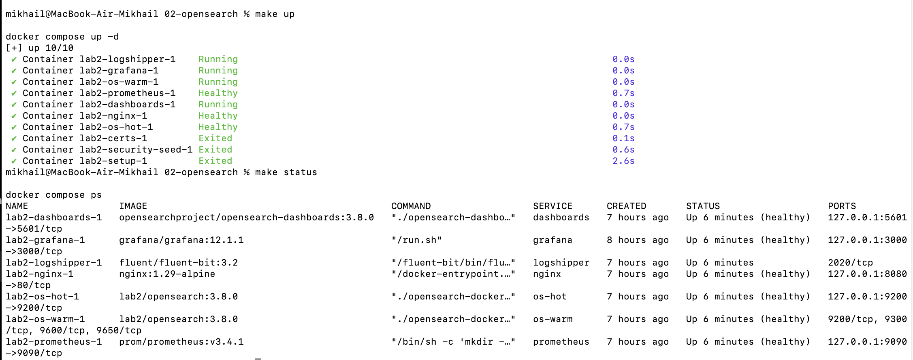

### Ролевая модель

Вывод `make rbac-matrix` показывает разрешённые и запрещённые действия трёх
пользователей. Запрет удаления потока проверяется имитацией проверки прав
OpenSearch без удаления данных.

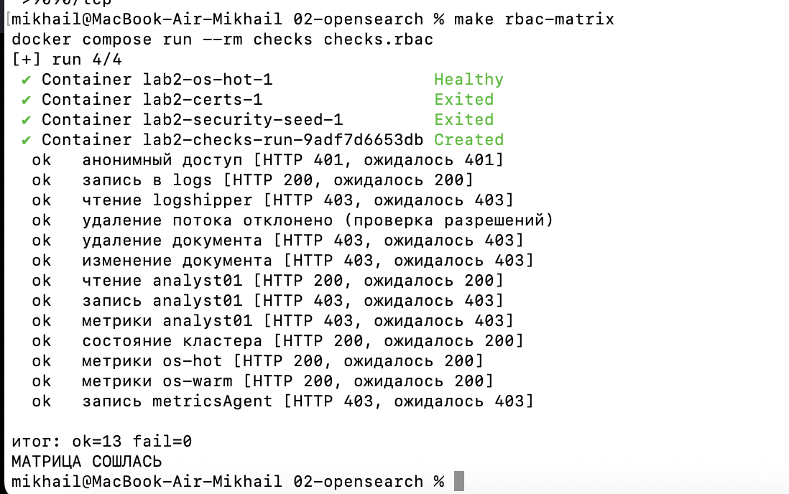

### Сбор логов и жизненный цикл

Проверка `make pipeline-check` подтверждает доставку тестовых запросов,
применение шаблона и размещение индекса записи. Вывод `make pipeline-cycle`
позволяет проследить одно поколение от rollover через warm/read-only до
удаления.

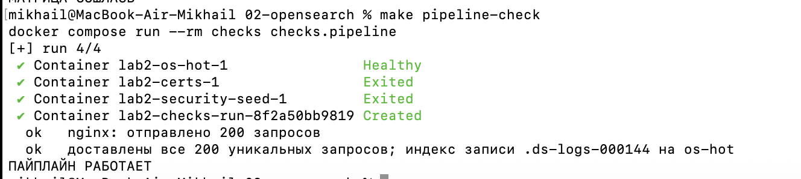

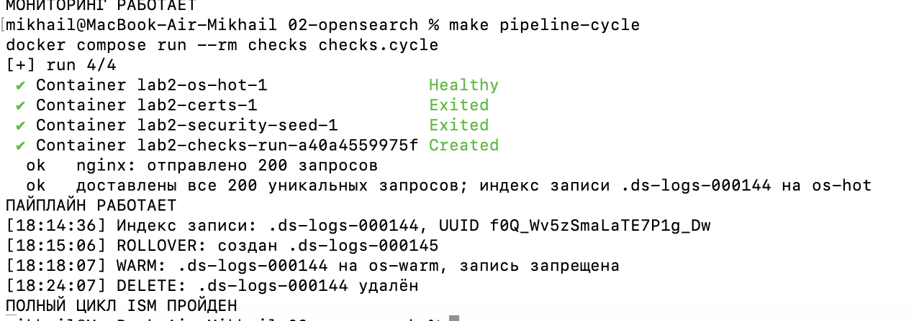

### Мониторинг и нагрузка

Проверка `make monitor-check` проверяет экспортёры, цели Prometheus и
дашборд Grafana.

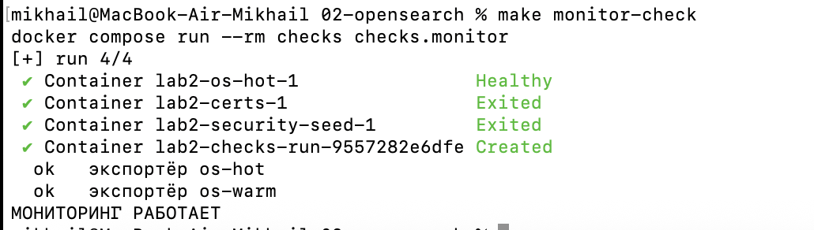

До запуска нагрузки дашборд показывает состояние кластера и использование
ресурсов узлов.

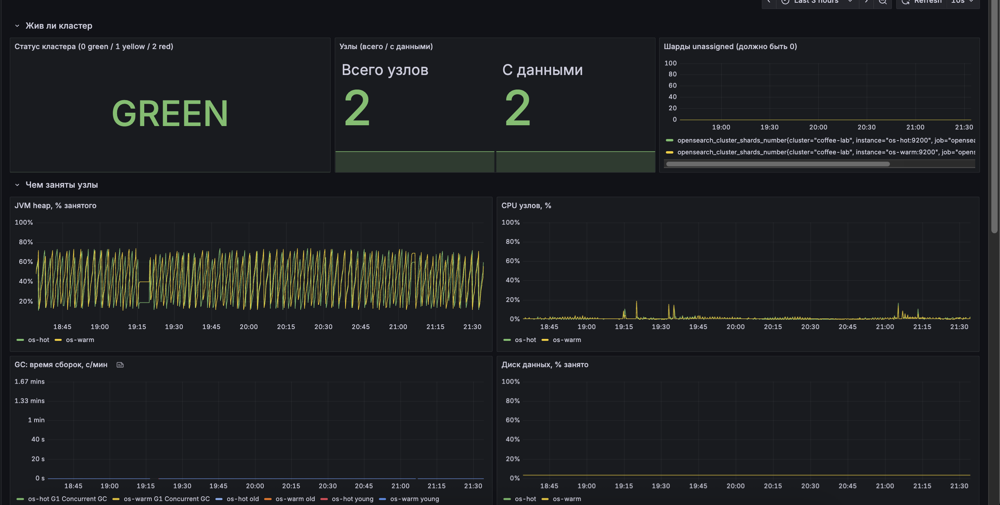

Во время прежней нагрузки Python-генератором на графике виден рост скорости
индексации на `os-hot`; снимок не относится к прогону k6.

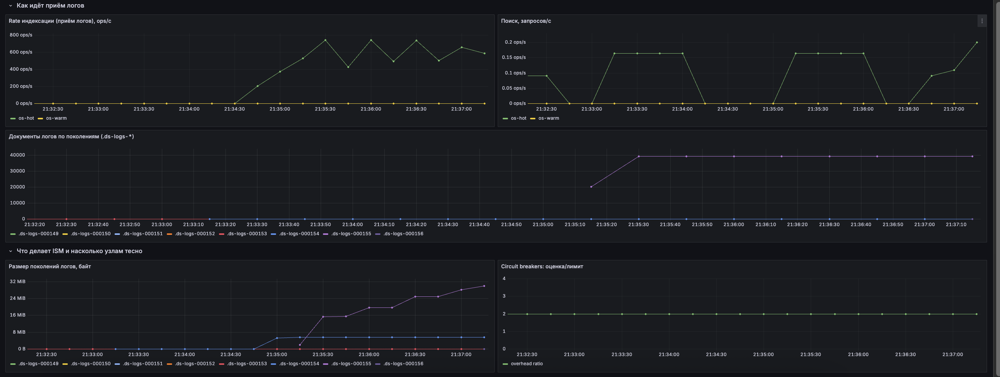

Генератор отправил 199 585 запросов: 138 131 успешный и 61 454 с ошибками.
На снимке приведён прежний вариант генератора, открывавший новое соединение
на каждый запрос; он не сохранял причины ошибок. В последующем прогоне с
разбивкой ошибок большинство составил `Can't assign requested address` —
вероятно, из-за нехватки локальных TCP-портов; встречались и тайм-ауты.
Точные причины ошибок именно на снимке восстановить нельзя.

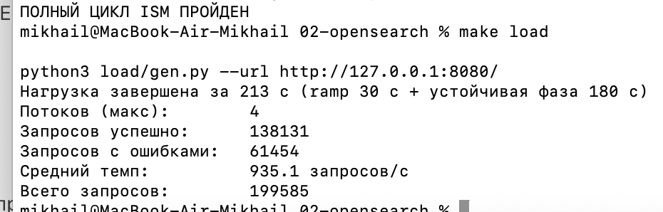

Следующая версия Python-генератора использовала переиспользуемое HTTP-соединение
для каждого потока и выводила разбивку ошибок. При ошибке соединение
закрывалось, а следующий запрос создавал новое. Такая нагрузка создавала меньше
TCP-соединений, поэтому её результаты напрямую не сопоставимы с прежним
прогоном на снимке.

Теперь `make load` использует k6: закреплённый образ
`grafana/k6:1.4.2` обращается к `http://nginx/` внутри сети Compose, без
секретов и опубликованных портов. Полный профиль: разгон до четырёх
виртуальных пользователей за 30 секунд и удержание 180 секунд. Ответы,
отличные от 200, и сетевые ошибки учитываются отдельно; при любой ошибке
порог проверки нарушается и команда возвращает ненулевой код. Для короткого
пробного запуска на уже работающем стенде:

```sh
docker compose run --rm --no-deps -e SMOKE=1 k6
```

Этот запрос создаёт записи в рабочем журнале nginx. Локальные интеграционные
тесты сценария можно запустить с установленным k6: `K6_BIN="$(command -v k6)"
python3 -m unittest discover -s tests -p test_k6.py -v`. Снимки предыдущих
прогонов Python приведены выше и ниже; они не относятся к k6. Успешные
HTTP-ответы не подтверждают доставку всех соответствующих записей в OpenSearch.

В одном полном прогоне k6 за 210 секунд получено 1 511 040 ответов HTTP 200,
ошибок HTTP и соединения не зафиксировано.

На снимках ниже — другой полный прогон k6: за 210 секунд выполнено
1 856 343 запроса, все проверки HTTP 200 прошли; во время нагрузки
на графике виден рост скорости индексации на `os-hot`.

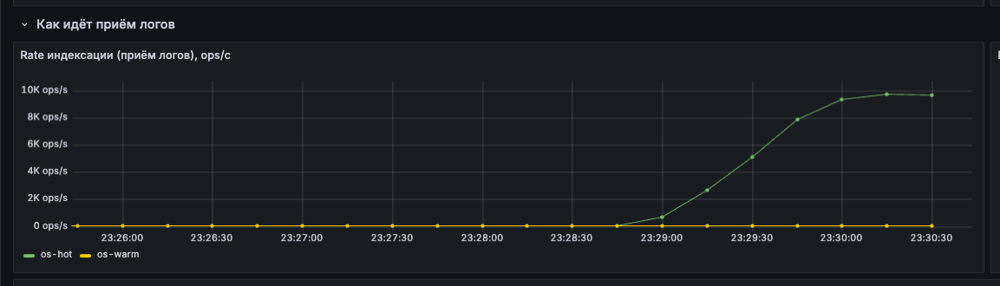

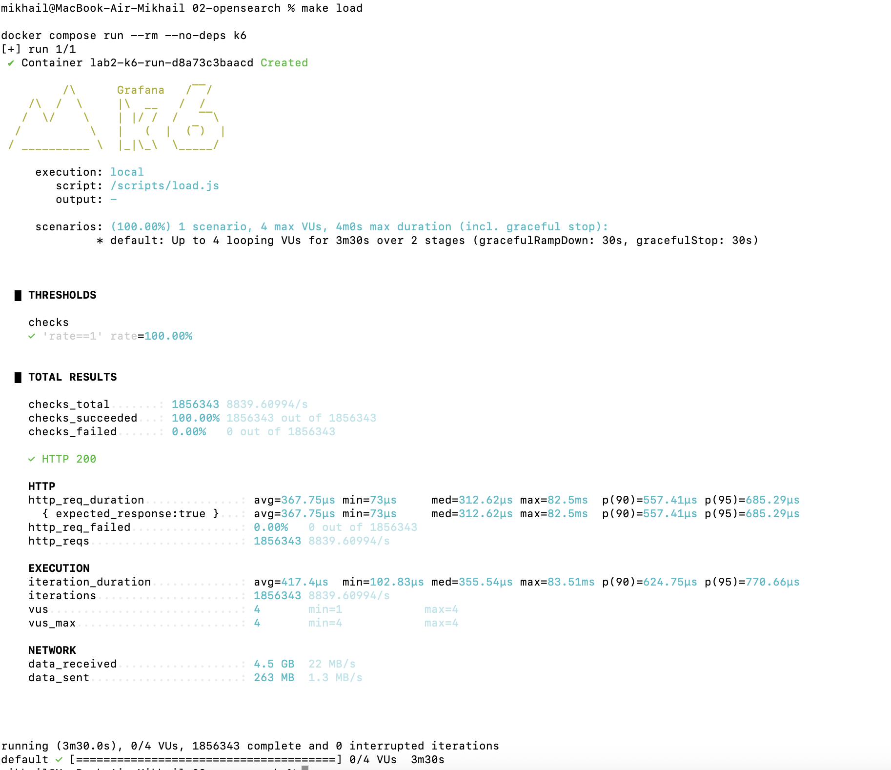

На прежнем полном прогоне Python с переиспользованием соединений за 210 секунд
выполнено 1 048 593 успешных запроса к nginx, ошибок генератор не
зафиксировал. Этот результат не подтверждает доставку всех логов в OpenSearch.

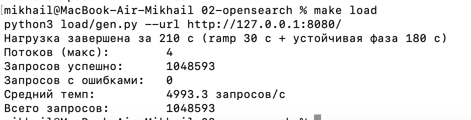

## Пароли и сертификаты

### Изменение паролей

- Пароли OpenSearch задаются при первоначальном создании security index.
- Изменение `.env` на работающем стенде само по себе не меняет пароли
  пользователей OpenSearch или администратора Grafana в существующем томе.
- Для смены пароля нужно отдельно обновить учётную запись и конфигурацию
  использующих её клиентов.

### Сертификаты и восстановление PKI

При первом запуске создаются локальный CA и сертификаты узлов. Если генерация
прервалась и часть файлов отсутствует, запуск завершится ошибкой, не
перезаписывая оставшиеся ключи.

Чтобы сохранить существующий стенд, восстановите недостающие файлы из
резервной копии. Повторное создание PKI без копии меняет доверенные ключи
и требует отдельного пересоздания и настройки стенда.

### Прерванное создание пользователей

Первичное создание пользователей отмечается в томе PKI. Если оно прервалось
или начальный файл пользователей отсутствует после инициализации:

1. Не удаляйте маркеры и не создавайте новые пароли поверх старого стенда.
2. Выясните состояние томов.
3. Восстановите совместимый комплект PKI и seed из резервной копии.

### Проверка раздельной подготовки

Разделение проверено в отдельном Compose-проекте на новых томах:

- После первого запуска и повтора одноразовых стадий сертификаты, ключи
  и начальные данные пользователей не изменились.
- Матрица RBAC прошла 13/13, проверка pipeline нашла 200 тестовых запросов.
- Мониторинг прошёл проверку при первом запуске.

Весь стек повторно не перезапускался.

## Ограничения доставки логов

- Позиция чтения файла сохраняется в отдельном томе, но очередь
  неподтверждённых записей не сохраняется на диске.
- Число повторов отправки ограничено пятью; длинные строки могут пропускаться.
- При длительной недоступности OpenSearch или сбое контейнера возможна потеря
  логов. `make pipeline-check` подтверждает доставку тестовых запросов при
  работающем стенде, но не гарантирует сохранность при сбоях.
