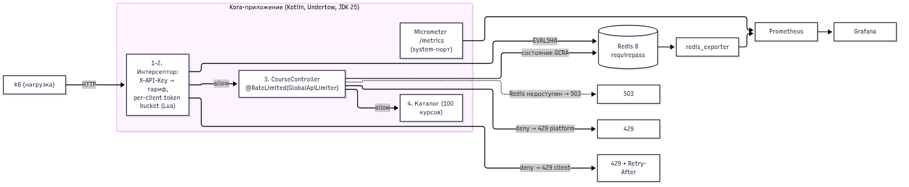
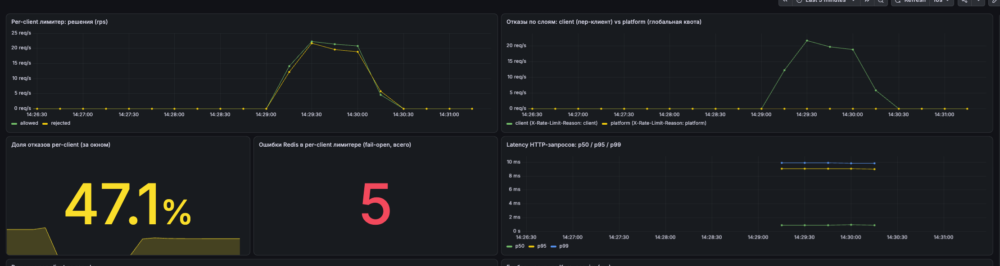
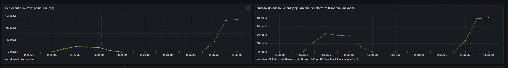
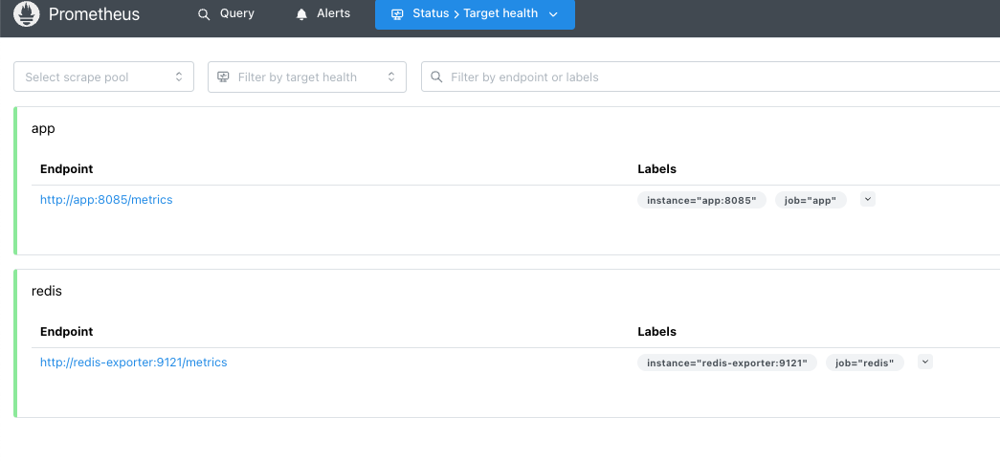
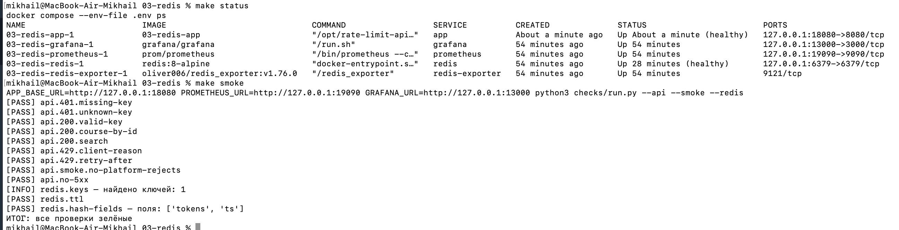
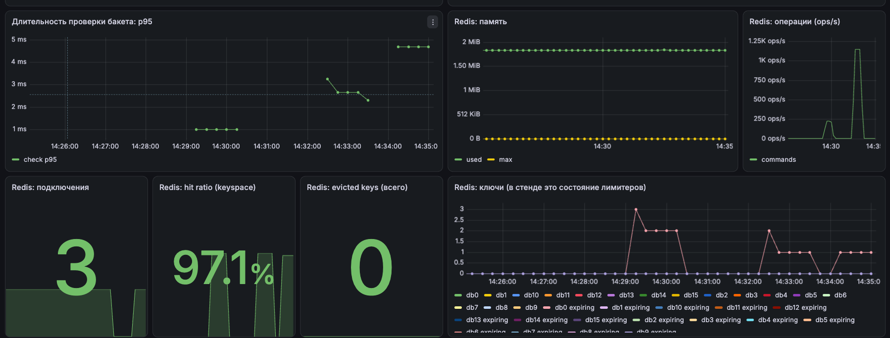

# Лабораторная работа №3 — Эксплуатация Redis (Rate Limiter)

> `subjects/nosql-databases/03-redis` · стек: Kora 2.0.0.RC2 + Kotlin 2.4.20 + Redis 8 + Prometheus/Grafana + k6

## Задача

Разработать и развернуть сервис, использующий Redis для решения практической задачи.

**Выбранный сценарий:** ограничение частоты запросов (Rate Limiter).

Предметная область — учебный «каталог курсов»: небольшой публичный JSON API
(данные статичны в памяти приложения; лаба про Redis, не про хранилище курсов).
Redis решает две задачи одновременно:

1. **Per-client token bucket** — собственный Lua-скрипт в Redis, ограничивает
   каждого клиента по API-ключу согласно тарифу.
2. **Глобальная квота API** — встроенный распределённый rate limiter Kora
   (`@RateLimiterDistributedSpec`), общее состояние в том же Redis.

Выбор Kora обоснован нативной поддержкой rate limiter'ов; per-client лимитации
в фреймворке нет (задокументировано) — она написана вручную и демонстрирует
умение работать с Redis из приложения.

## Чек-лист

- [x] [Выбрать сценарий и предметную область](#задача)
- [x] [Описать решаемую задачу и требования к системе](#требования)
- [x] [Подготовить архитектурную схему](#архитектура)
- [x] [Развернуть Redis и необходимые компоненты](#окружение-и-запуск)
- [x] [Реализовать минимально работающее приложение](#проверки-и-результаты)
- [x] [Провести нагрузочное тестирование системы](#нагрузочное-тестирование)
- [x] [Настроить мониторинг Redis и приложения](#дашборд)
- [x] [Создать дашборд с метриками](#дашборд)

## Требования

| № | Требование | Реализация |
|---|---|---|
| 1 | Ограничение частоты по клиенту, устойчивое к всплескам | token bucket (GCRA-пополнение), атомарный Lua-скрипт, 1 round trip |
| 2 | Различимость источников отказа | `X-Rate-Limit-Reason: client` / `platform`, разные метрики слоёв |
| 3 | Поведение при недоступном Redis | per-client fail-open, глобальная квота fail-closed (503) |
| 4 | Квоты настраиваются без кода | HOCON + env: тарифы `ratelimit.clients.*`, `GLOBAL_LIMIT_FOR_PERIOD` |
| 5 | Мониторируемость | Micrometer `/metrics` (system-порт), redis_exporter, Prometheus, Grafana |
| 6 | Воспроизводимость | Docker Compose, multi-stage образ, `make`-цели, тесты |

## Архитектура



Двухслойная лимитация в одном Kora-приложении. Порядок проверок фиксирован:
сначала per-client (интерсептор, до контроллера), затем глобальная квота
(AOP-аспект на методах контроллера). Отказ любого слоя короткозамыкает
обработку; состояние обоих слоёв живёт в Redis, решения — в метриках,
откуда видны в Prometheus и Grafana.

Ключевые решения:

- **Per-client token bucket** — вручную, Lua-скриптом (per-client лимитации
  в фреймворке нет): атомарно, один round trip на запрос. Ключ
  `ratelimit:client:<api-key>`, пополнение `min(capacity, tokens + elapsed·rate)`,
  TTL 60 с. Тарифы: `free` 10 rps/burst 20, `standard` 50 rps/burst 100,
  нет ключа → `401`, отказ → `429 client` + `Retry-After`.
- **Глобальная квота** — распределённый limiter Kora (`TOKEN_BUCKET`,
  300 rps, env `GLOBAL_LIMIT_FOR_PERIOD`), состояние в ключе
  `rate-limit-api:GlobalApiLimiter`; отказ → `429 platform`.
- **Отказ Redis** — per-client пропускает запрос (fail-open, ошибка в
  `ratelimit_redis_errors_total`), глобальная квота отказывает (fail-closed,
  `503`); итоговое наблюдаемое поведение при мёртвом Redis — `503`
  (проверяется `make chaos-test`).

## Окружение и запуск

Требования: Docker Desktop (проверено: 10 CPU / 8 GB), JDK 25 для тестов
(`openjdk@25`, keg-only), Python 3 для проверок, GNU make.

```bash
cd 03-redis
cp .env.example .env        # заполнить секреты (пароли, API-ключи)
make build                  # docker-образ приложения (gradle внутри multi-stage)
make up                     # docker compose up -d --wait весь стенд
make status                 # все контейнеры healthy
make unit-tests             # host-unittest разбора проверок (без сети)
make smoke                  # проверки API+Redis против живого стенда
make monitor-check          # Prometheus/Grafana проверки
make load PROFILE=fair      # k6-профиль (smoke|burst|fair|platform)
make chaos-test             # негативный сценарий «Redis недоступен»
make verify                 # up --wait + api + redis + monitor
make down                   # стоп без удаления томов
```

Порты на хосте публикуются только на 127.0.0.1. **Отличие от типовых схем**:
8080/3000/9090 на машине заняты стендом лабы №2, поэтому app → `127.0.0.1:18080`,
Grafana → `127.0.0.1:13000`, Prometheus → `127.0.0.1:19090`, Redis → `6379`.
Внутри compose-сети — стандартные 8080 (публичный) и 8085 (system: `/metrics`,
пробы); system-порт наружу не публикуется.

Юнит/интеграционные тесты приложения: `cd app && JAVA_HOME=<jdk25> ./gradlew test`
(14 тестов: 5 графов `@KoraAppTest` + класс чистых юнитов без графа; один общий
Testcontainers-Redis на JVM + изолированный для негативного теста; эфемерные
порты (`HTTP_PORT=0`) и клиент в обход системного прокси — с живым стендом
тесты не пересекаются).

## Структура файлов

```text
03-redis/
├── README.md                  # этот отчёт
├── app/                       # Gradle-проект Kora 2.0 (Kotlin + KSP)
│   ├── src/main/kotlin/dev/mikhail/ratelimit/
│   │   ├── Application.kt              # @KoraApp: граф модулей
│   │   ├── Course.kt / Catalog.kt      # статичный каталог (100 курсов)
│   │   ├── CourseController.kt         # GET /courses, /{id}, /search; @RateLimited
│   │   ├── UndertowRequestTimeConfigurer.kt  # см. «Ограничения» (п.2)
│   │   ├── ratelimit/                  # ClientRateLimiter (Lua), LimiterInterceptor,
│   │   │                               # ClientRegistry, GlobalApiLimiter, мапперы
│   │   └── metrics/RateLimitMetrics.kt # кастомные счётчики/таймер Micrometer
│   ├── src/main/resources/application.conf
│   └── src/test/kotlin/…               # @KoraAppTest + Testcontainers
├── docker-compose.yml         # app, redis, redis-exporter, prometheus, grafana, checks*, k6*
├── Dockerfile                 # multi-stage: gradle:9.8.0-jdk25 → temurin:25-jre-noble, non-root
├── Makefile                   # up/down/build/smoke/verify/load/chaos-test/…
├── .env.example               # образец секретов (сам .env в Git не попадает)
├── prometheus/prometheus.yml  # цели: app:8085/metrics, redis-exporter:9121
├── grafana/
│   ├── provisioning/          # datasource Prometheus + provider дашбордов
│   └── dashboards/rate-limit.json   # 14 панелей (см. «Дашборд»)
├── load/                      # k6-сценарии + README профилей + results/ (выводы прогонов)
├── checks/                    # python-проверки живого стенда (stdlib, без зависимостей)
└── tests/                     # unittest разбора ответов checks (хост, без сети)
```

`*` — сервисы `checks`/`k6` запускаются по профилям (`tools`/`load`), не постоянные.
`checks` в compose — вспомогательный: фактически проверки гоняются с хоста через
make, потому что redis-проверке нужен docker-сокет для `compose exec redis redis-cli`.

## Проверки и результаты

Формулировки честные: **[тест]** — проходит в gradle-сьюите; **[стенд]** —
проверено curl/python-проверками против живого compose-стенда; **[косвенно]** —
вывод из наблюдений, не прямой замер.

| Проверка | Ожидание | Результат | Доказательство |
|---|---|---|---|
| Каталог: 200/404/поиск | JSON-массив 100 курсов; несуществующий id → 404; `q` фильтрует | ✅ | [тест] `CatalogTest` (3) |
| Per-client алгоритм | capacity=20 → 20 allow; 21-й → 429+Retry-After; пополнение по `now`; idle-TTL сбрасывает бакет | ✅ | [тест] `ClientRateLimiterTest` (4) |
| 401 без/с чужим ключом | 401 | ✅ | [тест] `LimiterInterceptorTest`, [стенд] `make smoke` |
| 429 client: заголовки | `X-Rate-Limit-Reason: client`, `Retry-After` ≥ 0 | ✅ | [тест] + [стенд] smoke |
| Порядок client→platform | обе квоты исчерпаны → reason client | ✅ | [тест] `LimiterInterceptorTest#testClientCheckedBeforePlatform` |
| Глобальная квота | 429 + reason platform | ✅ | [тест] `GlobalLimiterTest` + [стенд] `load/platform` |
| Отказ Redis: смешанное поведение | fail-open (счётчик ошибок) + fail-closed (503) | ✅ | [тест] `RedisDownTest` |
| Метрики | `/metrics`: decisions{tier,result}, check_duration, redis_errors, resilient acquire, http duration, JVM | ✅ | [тест] `MetricsTest` (2), [стенд] `monitor-check` |
| Мониторинг | цели Prometheus up; ряды в БД; Grafana datasource+дашборд | ✅ | [стенд] `make monitor-check` (8 проверок) |
| Идемпотентность | повторный `make up`/`verify` не трогает тома и `.env` | ✅ | [стенд] down/up + verify×2, md5 `.env` совпал, ключи Redis сохранены |
| Redis-ключи состояния | `ratelimit:client:*` (hash tokens/ts, TTL>0); `rate-limit-api:GlobalApiLimiter` | ✅ | [стенд] redis-cli, `make smoke --redis` |

### Негативный сценарий: Redis недоступен

Три фазы подтверждены `make chaos-test` на живом стенде:

1. живой Redis → `200`×3, `ratelimit_redis_errors_total = 0`;
2. `docker compose stop redis` → 5×`503` (fail-closed глобальной квоты;
   per-client пропустил запросы, fail-open), счётчик ошибок вырос (0 → ≥5);
3. Redis поднят → снова `200` (Lettuce переподключился сам), счётчик стабилен.

Состояние бакетов за время простоя обнуляется TTL — ожидаемое поведение:
лимиты эфемерны, после восстановления клиенты получают полный бакет.

### Нагрузочное тестирование

k6 1.4.2 внутри compose-сети; выводы прогонов — `load/results/*.txt`.

Тарифы/квоты: free 10 rps/burst 20, standard 50 rps/burst 100, глобальная 300 rps.

| Профиль | Схема | Ожидалось | Факт |
|---|---|---|---|
| smoke | standard, 5 rps, 30 с | все 200 | ✅ 151/151×200, avg 4.1 мс |
| burst | free: мгновенные 30, затем 25 rps×20 с | burst ≈20 allow/10 deny; steady ~10 rps allow | ✅ 20/10; allow 219 (≈9.5 rps), deny 281 — всё с reason `client` |
| fair | heavy standard 120 rps + light free 5 rps ×20 с | light 100% allow; heavy ≥50% deny(client) | ✅ light 101/0; heavy 1099 allow / 1302 deny (54.22%), reason `client` |
| platform | 8×60 rps = 480 rps ×20 с, one standard-ключ | 429 `platform` есть; 429 `client` нет; 5xx нет | ✅ allowed 6979 (≈348.8 rps), rejected platform 2628, client 0, 5xx 0 |

Таблица цитирует `load/results/`: smoke-134404, burst-134539, fair-155307,
platform-143219 (скриншоты 1–2 сделаны во время fair-142900 и platform-143219
прогонов — цифры fair там те же в пределах шумов).

Пропуск platform-профиля ≈348.8 rps при квоте «300» — это не неточность стенда, а
арифметика GCRA-реализации Kora: эмиссионный интервал `1000мс / 300 = 3` (целочисленное
деление), то есть steady-поток ≈333 rps, плюс стартовый бакет на 300 токенов,
размазанный по 20 с (+15 rps). 333 + 15 = 348 — совпадает с фактом.
Нюанс профиля `platform`: API-ключ идентичен тарифу, поэтому «8 клиентов» —
это 8 параллельных источников с одним ключом. Чтобы per-client слой не
отсекал раньше глобального, прогон временно поднимает app с
`RATELIMIT_STANDARD_RATE=1000` (делает `make load PROFILE=platform` и возвращает
конфиг обратно). Без этого глобальная квота недостижима (per-client пропускает
не более 50 rps).

Сводные ряды после прогонов видно на дашборде (панели «решения», «отказы по слоям»).

## Дашборд

Grafana provisioning (`grafana/provisioning/…`), дашборд **«Redis Rate Limiter — ЛР-3»**
(`grafana/dashboards/rate-limit.json`, 14 панелей, refresh 10 s):

- per-client решения allowed/rejected (rps) и разбивка по тарифам;
- различение отказов: client (метрика решений) vs platform (`resilient_ratelimiter_acquire`);
- доля отказов (stat) и ошибки Redis fail-open (stat);
- latency HTTP p50/p95/p99 (`http_server_request_duration`), p95 проверки бакета;
- Redis: память, ops/s, подключения, hit ratio, evicted, количество ключей.

Проверка `[стенд]`: `make monitor-check` (дашборд находится Grafana API; все
запросы панелей отдают данные — имена серий сверялись с живым Prometheus,
панель «ключи» использует `redis_db_keys`, см. «Ограничения» п.4).

### Скриншоты

**1. Дашборд под нагрузкой** (профиль `fair`, окно Last 5 minutes): per-client
решения, отказы по слоям, доля отказов, ошибки Redis, latency p50/p95/p99.



**2. Различимость отказов: client vs platform.** Жёлтая кривая слева —
`client`-отказы из fair-прогона; справа наросла кривая `platform` — разгар
platform-прогона (480 rps при квоте 300). Два источника 429 различимы и по
заголовку, и по метрике.



**3. Prometheus собирает оба источника** — цели `app` (system-порт 8085) и
`redis` (redis-exporter) в статусе UP.



**4. Стенд и smoke-проверки** — `make status` (все контейнеры healthy) и
`make smoke` против живого стенда (401/200/429+заголовки, состояние Redis).



**5. Мониторинг Redis** — память, ops/s (пик — platform-прогон), подключения,
hit ratio, evicted, количество ключей (ступеньки = бакеты лимитеров с TTL).



## Ограничения и известные проблемы

1. **Kora 2.0.0.RC2 — release-кандидат.** «Тихие» отказы конфигурации в нём
   реальны, поэтому спорные места закрыты поведенияческими тестами, а не
   компиляцией.
2. **`http.server.request.duration` в RC2 требует явно включить Undertow
   `RECORD_REQUEST_START_TIME`.** Без него длительность считается от
   системного `nanoTime` и равна uptime процесса (для этого в коде
   `UndertowRequestTimeConfigurer`).
3. **Приложение не стартует без Redis**: распределённый limiter Kora открывает
   соединение при инициализации. Fail-open/fail-closed — про рантайм, не про
   старт; в compose-стенде это штатно (`depends_on: healthy`).
4. **redis_exporter не считает ключи по шаблону**: опция CHECK_KEYS добавила бы
   имена ключей в лейблы метрик, а в именах — API-ключи, поэтому не включена.
   Панель количества ключей показывает общий `redis_db_keys`.
5. HTTPS/TLS, аутентификация, кластеризация Redis и персистентность лимитов —
   вне объёма учебной лабы.
