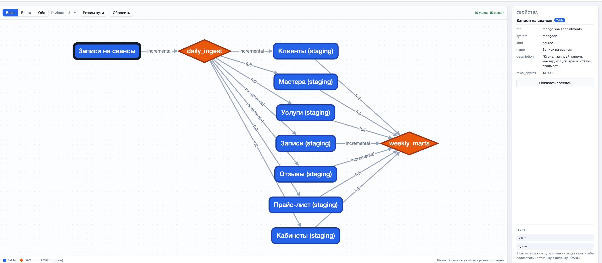
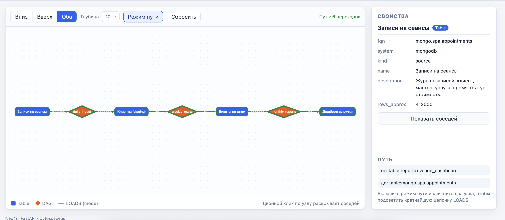
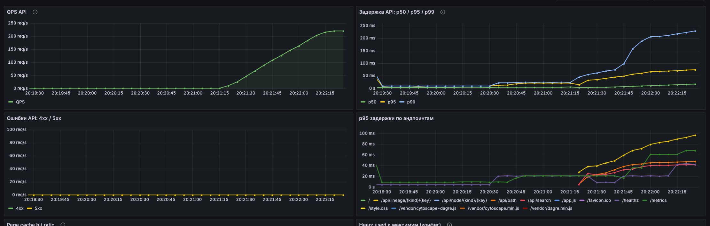
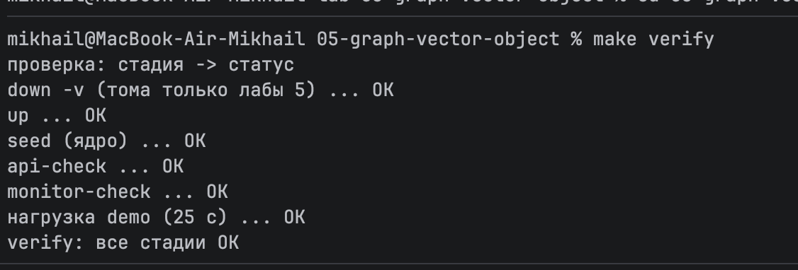

# Лабораторная работа №5 — Графовая база данных в каталоге Data Lineage

## Задача

SPA-студия собирает данные из MongoDB, CSV-файлов и ClickHouse, строит витрины и отчёты. Между источниками, промежуточными слоями и отчётами образуется сеть зависимостей: чтобы понять, откуда взялось число в отчёте или что сломается при изменении таблицы, приходится разбирать конфигурации загрузчиков вручную.

В работе реализован каталог Data Lineage: сервис, который хранит граф зависимостей таблиц и загрузчиков, показывает происхождение данных вверх и вниз по графу, ищет узлы по имени и описанию и находит кратчайший путь между двумя таблицами. Граф хранится в Neo4j, доступен через HTTP API и веб-интерфейс, за работой сервиса следят Prometheus и Grafana.

**Направление:** графовая база данных, Neo4j 5.26.

## Требования

- Хранить таблицы и загрузчики (DAG) со свойствами: имя, система-источник, слой, описание, расписание, шаги.
- Хранить связи «таблица → загрузчик → таблица» с режимом загрузки `full` или `incremental`.
- Не допускать циклов в графе зависимостей.
- Отдавать подграф происхождения вверх и вниз с ограничением глубины и размера.
- Искать узлы по имени и описанию, в том числе по кириллице и составным ключам с точками.
- Находить кратчайший путь между двумя узлами.
- Показывать граф в браузере: направление слоёв слева направо, таблицы и загрузчики разными цветами.
- Экспортировать метрики API и Neo4j в Prometheus и показывать их на дашборде Grafana.
- Выдерживать смешанную нагрузку без ошибок 5xx; p95 запросов lineage глубины ≤ 4 — ниже 500 мс.

## Почему Neo4j

Задача — обход связей переменной глубины: «покажи всё, что ниже этой таблицы, на 6 шагов» и «найди путь между источником и отчётом». В реляционной схеме такие запросы требуют рекурсивных CTE и заранее известной максимальной глубины, а каждый шаг — дополнительного соединения. Neo4j хранит связи как полноценные объекты, наравне с узлами, и выполняет обход за время, пропорциональное размеру посещённого подграфа, а не всей таблицы связей.

Дополнительно Neo4j даёт:

- ограничения уникальности и полнотекстовый индекс без внешнего поискового движка;
- язык Cypher с переменной длиной пути `[:LOADS*1..6]` и `shortestPath`;
- экспорт метрик в формате Prometheus в редакции Enterprise;
- официальный Bolt-драйвер для Python.

Neo4j Community не отдаёт Prometheus-эндпоинт, поэтому стенд использует `neo4j:5.26-enterprise` с Developer-лицензией. Это учебный локальный стенд, не промышленная эксплуатация.

## Архитектура

```text
┌──────────────┐   Bolt :7687    ┌──────────────────┐
│  Neo4j 5.26  │◄────────────────│  FastAPI + UI    │
│  граф + FT   │                 │  :28080          │
└──────┬───────┘                 └────────┬─────────┘
       │ :2004 (Prometheus)               │ /metrics
       ▼                                  ▼
┌──────────────────────────────────────────────────┐
│              Prometheus :29090                   │
└──────────────────────┬───────────────────────────┘
                       ▼
              ┌─────────────────┐
              │  Grafana :23000 │
              └─────────────────┘
```

Все порты опубликованы только на `127.0.0.1`. Сервис `seed` — one-shot контейнер загрузки данных, в обычном `up` не запускается.

| Компонент | Версия | Порт | Назначение |
|---|---|---|---|
| Neo4j | 5.26 Enterprise | 7474, 7687 | хранение графа, Cypher, метрики |
| API + UI | Python 3.12, FastAPI 0.115 | 28080 | HTTP API, статика Cytoscape.js |
| Prometheus | 3.4.1 | 29090 | сбор метрик |
| Grafana | 12.1.1 | 23000 | дашборд, анонимный Viewer |

## Модель данных

Узлы:

```cypher
(:Table {
  fqn: "mart.visits_daily",   // уникальный ключ
  name: "Визиты по дням",
  system: "clickhouse",       // mongodb | csv | clickhouse | report
  kind: "mart",               // source | staging | mart | report
  description: "…",
  rows_approx: 4600
})

(:DAG {
  name: "daily_ingest",       // уникальный ключ
  description: "…",
  schedule: "0 2 * * *",
  engine: "python",           // python | sql
  owner: "data-platform",
  steps: 9                    // число шагов
})
```

Связи:

```cypher
(:Table)-[:LOADS {mode: "incremental"}]->(:DAG)
(:DAG)-[:LOADS {mode: "full"}]->(:Table)
```

Схему и полнотекстовый индекс создаёт загрузчик:

- `table_fqn` — уникальность `Table.fqn`;
- `dag_name` — уникальность `DAG.name`;
- `nodeSearch` — полнотекстовый индекс по `name` и `description` для `Table` и `DAG`.

Идентификатор узла в API — `table:<fqn>` или `dag:<name>`. Точки в составных ключах (например, `mongo.spa.appointments`) допустимы: ключ передаётся как хвост URL-пути.

Ядро графа: 7 источников → `daily_ingest` → 7 staging-таблиц → `weekly_marts` → 5 витрин → `monthly_reports` → 6 отчётов. Всего 25 таблиц, 3 DAG и 37 связей. Данные синтетические, но структура повторяет типовой конвейер студии.

Генератор масштаба добавляет 5000 таблиц и 1500 DAG, сохраняя ацикличность по построению: связи идут только из слоя в следующий слой. Каждая таблица получает хотя бы одну связь. Итоговый стенд масштаба: 5025 таблиц, 1503 DAG, 9288 связей.

Загрузчик проверяет циклы алгоритмом DFS до записи. При обнаружении цикла возвращается путь цикла, транзакция отменяется, граф не меняется. Запись идёт батчами по 500 строк через `MERGE`, поэтому повторная загрузка идемпотентна.

## API

| Метод и путь | Назначение |
|---|---|
| `GET /healthz` | проверка связи с Neo4j: 200 или 503 |
| `GET /api/search?q=` | полнотекстовый поиск, до 20 результатов |
| `GET /api/node/{kind}/{key}` | карточка узла |
| `GET /api/lineage/{kind}/{key}?direction=up\|down\|both&depth=N` | подграф происхождения, глубина 1–10 (по умолчанию 3) |
| `GET /api/path?from=&to=` | кратчайший путь между узлами |
| `GET /metrics` | метрики Prometheus |
| `GET /` | веб-интерфейс |

Ограничения подграфа: до 2000 путей на каждое направление обхода и не более 2000 узлов в ответе; при срабатывании лимита ответ содержит `"truncated": true`. Неизвестный узел — 404, некорректная глубина или направление — 400, невалидный поисковый запрос — 400, недоступный Neo4j — 503.

Поиск сначала использует индекс `nodeSearch`, затем, если результатов меньше лимита, дополняет их подстрочным поиском по `fqn` и `name`. Это нужно потому, что полнотекстовый индекс не покрывает `fqn`, а пользователи ищут и по имени таблицы вида `mongo.spa.appointments`.

## Данные и загрузка

```bash
make up          # Neo4j, API, Prometheus, Grafana; .env создаётся один раз
make seed        # ядро: 25 таблиц, 3 DAG, 37 связей
make seed-scale  # +5000 таблиц и +1500 DAG
```

`make up` не пересоздаёт `.env`, если файл уже есть. Пароль генерируется локально (`openssl rand -hex 16`), в репозиторий попадает только `.env.example` с заглушкой. Перед запуском проверяется доступность Docker, после запуска печатается состояние контейнеров.

## Интерфейс

Одна статическая страница на Cytoscape.js с раскладкой dagre (`rankdir=LR`):

- таблицы — синие скруглённые прямоугольники, DAG — оранжевые ромбы;
- поиск с выпадающим списком и переходом к узлу;
- направления «вниз», «вверх», «оба» и глубина 1–10;
- панель свойств выбранного узла;
- режим пути: два клика по узлам, подсветка найденной цепочки;
- двойной клик раскрывает соседей без перезагрузки графа;
- подписи связей показывают режим загрузки.

Библиотеки Cytoscape.js, dagre и cytoscape-dagre вендорены в `app/static/vendor` вместе с текстами лицензий MIT.

## Показатели

Показатели подобраны под задачи эксплуатации:

- **задержка API** — p50/p95/p99 по типам запросов (lineage, path, search);
- **интенсивность** — QPS и распределение запросов по эндпоинтам;
- **надёжность** — количество ответов 4xx и 5xx;
- **эффективность кэша Neo4j** — page cache hit ratio: при росте графа именно кэш определяет, читаются ли данные с диска;
- **память** — heap used относительно настроенного максимума;
- **запись** — скорость коммитов транзакций;
- **обслуживание** — длительность checkpoint;
- **параллелизм** — активные транзакции чтения и записи;
- **размер и форма графа** — число узлов, связей, глубина и fanout (фиксируются запросами Cypher и в отчёте).

Пороговые значения для стенда: 0 ответов 5xx и p95 lineage глубины ≤ 4 ниже 500 мс. Оба порога проверяются в нагрузочных прогонах.

## Нагрузочное тестирование

Нагрузка — Grafana k6 (`grafana/k6:1.4.2`), как в лабах 2–3: сервис `k6` в compose, сценарий `load/load.js`, запуск `docker compose run --rm k6`. Профиль: ramp 30 с, steady 180 с, 8 VU. Смесь запросов: 60% lineage (глубина 2–6, направления up/down), 25% path, 15% search. Цели собираются в `setup()` из графа через поиск и обход; для path берутся рёбра, которые API уже вернул, поэтому проверяется существующий путь, а не заведомый 404. Пустой стенд — `setup()` падает с подсказкой загрузить данные.

Запуск:

```bash
make load-smoke  # 1 с, проверка порогов
make load-demo   # ядро, 210 с
make load-scale  # масштаб, 210 с
```

Пороги приёмки заданы в сценарии: `server_errors count==0`, `checks rate==1`, `http_req_duration{type:lineage,depth:2|3|4} p(95)<500` мс. Сводку печатает сам k6 (`--summary-trend-stats`); выводы прогонов сохранены в `measurements/load-demo.txt` и `load-scale.txt`.

Результаты на стенде 10 vCPU / 7,75 ГиБ:

| Прогон | Запросов | QPS | p95 lineage | p95 path | p95 search | 4xx | 5xx |
|---|---:|---:|---:|---:|---:|---:|---:|
| demo, ядро | 52 788 | 251,3 | 98,8 мс | 51,2 мс | 46,1 мс | 0 | 0 |
| scale, 6528 узлов | 74 963 | 356,3 | 59,9 мс | 35,3 мс | 38,2 мс | 0 | 0 |

checks — 100% в обоих прогонах, server_errors — 0.

p95 lineage по глубине:

| Глубина | 2 | 3 | 4 | 5 | 6 |
|---|---:|---:|---:|---:|---:|
| scale, мс | 34,4 | 42,3 | 53,8 | 68,0 | 86,7 |
| ядро, мс | 50,9 | 58,0 | 77,6 | 101,1 | 270,5 |

Порог p95 < 500 мс для глубин 2–4 выполнен с запасом (худшее — 77,6 мс на ядре). На ядре глубина стоит дороже, чем на масштабе. Причина отдельно не измерялась; вероятное объяснение — состав целевых узлов: в масштабном графе выборка чаще попадает на периферийные таблицы с небольшими подграфами, а в ядре — на плотные хабы; лимит в 2000 путей при этих глубинах не достигается.

Клиентский счётчик сверен с серверным. В контрольном прогоне (MODE=verify, 25 с) k6 отправил 9768 запросов, а серверный `api_requests_total` вырос на 9776; разница — healthcheck контейнера, scrape `/metrics` Prometheus и запросы, находившиеся в полёте на момент снятия счётчика. Совпадение с точностью до служебных запросов подтверждает, что нагрузка доходила до API.

В Prometheus за окно прогонов максимум QPS — 362, максимум p95 — 86 мс, page cache hit ratio — 1,0. Рост QPS и задержек в окне нагрузки виден на дашборде.

## Мониторинг

Prometheus собирает метрики с двух целей каждые 5 секунд:

- `neo4j:2004` — метрики Neo4j;
- `api:28080/metrics` — метрики FastAPI.

API отдаёт гистограмму `api_request_duration_seconds` с метками `endpoint` и `status` и счётчик `api_requests_total`. Дашборд Grafana «Lineage — Neo4j» содержит 10 панелей:

1. QPS API;
2. p50/p95/p99 задержки API;
3. ошибки 4xx и 5xx;
4. p95 по эндпоинтам;
5. page cache hit ratio;
6. heap used и настроенный максимум;
7. скорость коммитов транзакций;
8. длительность checkpoint;
9. активные транзакции чтения и записи;
10. запросы по эндпоинтам.

Отдельной серии heap max в Neo4j 5.26 нет, поэтому на панели памяти вторая линия — константа `vector(1073741824)`, то есть настроенный лимит 1 ГиБ, а не измерение.

Grafana открыта анонимно в роли Viewer, форма входа отключена. Дашборд провижинится из файла, ручные правки не сохраняются.

## Проверки

| Проверка | Команда | Результат |
|---|---|---|
| unit-тесты | `make test` | 10 passed |
| интеграционные тесты | `make test-integration` | 18 passed |
| API на стенде | `make api-check` | 9/9 OK; проверка разрыва компонент — SKIP без масштаба |
| мониторинг | `make monitor-check` | 7/7 OK |
| полный цикл с нуля | `make verify` | 6/6 стадий OK; в core-режиме проверка разрыва компонент — SKIP |
| идемпотентность загрузки | повторный `make seed` | те же 25/3/37 |
| идемпотентность `up` | повторный `make up` | 25/3/37 не изменились |
| нагрузка | `make load-demo`, `make load-scale` | 0 ошибок 5xx |

`make verify` — единственная цель, которая удаляет данные: она выполняет `docker compose down -v` для проекта `lab05`, затем поднимает стенд, загружает ядро, прогоняет проверки API и мониторинга и короткую нагрузку. Обычные `make down` и `make up` тома сохраняют.

## Запуск

Требования: Docker Desktop с Compose, Python 3.9+ для локальных тестов, свободные порты 7474, 7687, 23000, 28080, 29090.

```bash
cd 05-graph-vector-object
make up
make seed
make ui          # http://127.0.0.1:28080/
```

Тесты локально:

```bash
python3 -m venv .venv
.venv/bin/pip install -r requirements-dev.txt
make test
make test-integration   # нужен поднятый и загруженный стенд (make up && make seed) и .env
```

Остановка:

```bash
make down        # сохраняет тома
make verify      # пересоздаёт стенд с нуля (удаляет тома lab05)
```

## Структура каталогов

```text
05-graph-vector-object/
├── app/
│   ├── main.py              # FastAPI, маршруты, метрики
│   ├── graph.py             # Cypher-запросы, подграф, путь, поиск
│   ├── seed.py              # схема, загрузка, проверка циклов
│   ├── generate.py          # генератор масштаба
│   ├── core.json            # ядро графа
│   ├── static/              # UI и вендоренные библиотеки
│   └── tests/               # unit и интеграционные тесты
├── load/
│   └── load.js              # сценарий нагрузки k6
├── monitoring/
│   ├── prometheus.yml
│   └── grafana/             # datasource, provisioning, дашборд
├── docker-compose.yml
├── Makefile
└── README.md
```

## Скриншоты

Lineage от `mongo.spa.appointments`, глубина 3 — источник, DAG и staging-слой:



Режим пути `mongo.spa.appointments` → `report.revenue_dashboard` — кратчайшая цепочка LOADS, 6 переходов:



Дашборд Grafana под нагрузкой — QPS, p50/p95/p99, ошибки:



`make verify` — все стадии OK:



## Восстановление

Если стенд не отвечает:

```bash
make status                  # состояние контейнеров
make logs                    # логи всех сервисов
make up                      # досоздать недостающие контейнеры
make seed                    # идемпотентно восстановить ядро
```

Если повреждён том или нужен чистый эксперимент — `make verify` (удаляет только тома `lab05`). Пароль хранится в локальном `.env`; при его удалении `make up` создаст новый. Neo4j применяет `NEO4J_AUTH` только к пустому тому, поэтому со старым томом новый пароль не подойдёт: либо верните прежний пароль в `.env`, либо пересоздайте стенд через `make verify` и загрузите данные заново.